<!-- LIMGEEK • Signal Studio profile. Visual assets are maintained in ./assets/. -->

  <picture>
    <source media="(prefers-color-scheme: dark)" srcset="./assets/hero-dark.svg" />
    
  </picture>

  <a href="https://www.limgeek.com" title="Personal website"><picture><source media="(prefers-color-scheme: dark)" srcset="./assets/button-website-dark.svg" /></picture></a>
  &nbsp;
  <a href="https://github.com/Limzeuk" title="GitHub profile"><picture><source media="(prefers-color-scheme: dark)" srcset="./assets/button-github-dark.svg" /></picture></a>
  &nbsp;
  <a href="mailto:Hello@limgeek.com" title="Email"><picture><source media="(prefers-color-scheme: dark)" srcset="./assets/button-email-dark.svg" /></picture></a>

  <picture>
    <source media="(prefers-color-scheme: dark)" srcset="./assets/signal-dark.svg" />
    
  </picture>

 

<code>01 / ABOUT THIS SPACE</code>

## An open notebook, always in progress.

> **A place for code, curiosity, and ideas in motion.**
>
> Somewhere between a digital garden, a workshop, and a tiny corner of the internet.

 

<code>02 / LATEST WRITINGS</code>

<!-- LIMGEEK-RSS:START -->
<table width="100%">
  <tr>
    <td valign="top">
      <code>2026.06.10</code>
      <h3><a href="https://limgeek.com/posts/2026/06/vue-theme-test-document/">测试文档</a></h3>
      
描述内容，这是一篇排版测试文档

    </td>
  </tr>
  <tr>
    <td valign="top">
      <code>2026.06.09</code>
      <h3><a href="https://limgeek.com/posts/2026/06/over-engineering/">现代 Web 性能优化的剃刀原理：告别过度工程</a></h3>
      
深入分析 Astro Islands 架构如何通过在服务端彻底剥离不必要的 JavaScript 运行时来提升首屏性能。

    </td>
  </tr>
  <tr>
    <td valign="top">
      <code>2026.06.08</code>
      <h3><a href="https://limgeek.com/posts/2026/06/double-link-garden/">数字花园的进化：为什么块级双链是知识管理的终局？</a></h3>
      
探讨从线性笔记到网状知识库的认知转变，以及如何在 Emacs Org-mode 中打通极致的局部原子化链接。

    </td>
  </tr>
</table>
<!-- LIMGEEK-RSS:END -->
